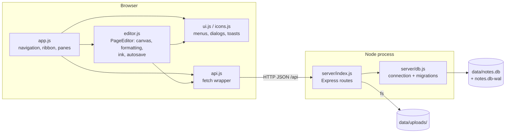

# OneNote Clone — Build Plan

A self-hosted, OneNote-style notes web app (notebooks → sections → pages, freeform canvas, ink,
search) with SQLite persistence, for my own day-to-day note-taking. It exists because I like how
OneNote organises notes, but want the data in a file I own, an app I can change, and no account
or sync service in between. Phase 0 (a faithful clone) was built on 2026-10-14. From here on, the
work is customizing it to how I actually take notes.

> Written 2026-10-15, one day after the v1 build, so §1–§4 record the intent behind code that
> already exists, not a plan made in advance. Changes of direction from here are logged in
> [4_decisions.md](4_decisions.md) rather than edited in silently.

## 1. Tech stack

| Layer     | Tool                                               | Why this one                                                                                                                                              |
| --------- | -------------------------------------------------- | --------------------------------------------------------------------------------------------------------------------------------------------------------- |
| Runtime   | Node.js ≥ 22.13 (developed on 26.11.1)            | Ships `node:sqlite`, so the database needs no native module.                                                                                            |
| Database  | SQLite via built-in `node:sqlite`, WAL mode      | One file, no server process, transactional, fast enough for one person (search ~24 ms at 2k pages, measured). WAL lets backups read while the app writes. |
| HTTP      | Express 5                                          | Routing, static files, body parsers, async error forwarding: one dependency instead of ~150 hand-written lines.                                           |
| Frontend  | Plain ES modules + HTML + CSS                      | No build step. The editor is `contenteditable`, which a virtual-DOM framework would fight rather than help.                                             |
| Rich text | `contenteditable` + `document.execCommand`     | The only engine available without a bundler. Deprecated but universally shipped (OD5).                                                                    |
| Ink       | Inline SVG paths smoothed from stored point arrays | Points make geometric erasing possible; SVG scales with zoom.                                                                                             |
| Icons     | Hand-written inline SVG (`public/js/icons.js`)   | No icon font or CDN, so it works offline.                                                                                                                 |
| Tests     | `node:test` + `playwright-core` (dev only) driving the installed Chrome | Every bug so far was a browser bug; this drives the real browser with no 150 MB download and no second test runner (decisions 2026-10-15). |

**Deliberately not used:**

| Not used                       | Why not                                                                                                                                                |
| ------------------------------ | ------------------------------------------------------------------------------------------------------------------------------------------------------ |
| React / Vue / Vite             | A build step and a frontend dependency tree for a ~4.5k-line app.                                                                                      |
| ProseMirror / Tiptap / Lexical | Need a bundler. Revisit only if `execCommand` blocks a customization (OD5).                                                                          |
| `better-sqlite3`             | A native module that needs a toolchain on Windows. `node:sqlite` does the same job.                                                                  |
| An ORM                         | Four tables and about 40 hand-written statements (33 single-line ones counted by grep on 2026-10-15). An ORM would hide the SQL it exists to simplify. |
| Authentication                 | Single user on localhost (OD4 for when that changes).                                                                                                  |
| Any CDN at runtime             | The app must work with no internet.                                                                                                                    |

## 2. Architecture

- **`server/index.js`**: every route, validation, seeding and trash purging. Depends on `db.js`.
  Knows nothing about the page `content` format; it stores the string.
- **`server/db.js`**: opens the database, sets the pragmas, runs migrations. Independent of HTTP.
- **`public/js/editor.js` (`PageEditor`)**: everything inside one page. Depends on `api.js` (save
  and upload) and `ui.js` (toasts, the container menu). Knows nothing about notebooks or sections,
  which is what makes it the place to customise page behaviour without touching navigation.
- **`public/js/app.js`**: everything around the page (notebooks, sections, page list, search,
  recent, trash, ribbon, shortcuts). Talks to the editor only through its methods and events
  (`status`, `saved`, `title`, `selection`, `mode`, `painter`, `dictation`).
- **`public/js/ui.js`, `icons.js`, `api.js`**: leaf modules with no app knowledge. They can be
  tested or replaced in isolation.

## 3. Data / domain model

    notebook 1──* section 1──* page          (ON DELETE CASCADE all the way down)
    settings: key → JSON value

| Entity        | Shape (columns)                                                                                                                                                  |
| ------------- | ---------------------------------------------------------------------------------------------------------------------------------------------------------------- |
| `notebooks` | `id`, `name`, `color`, `sort`, `created_at`, `updated_at`                                                                                            |
| `sections`  | `id`, `notebook_id`, `name`, `color`, `sort`, `created_at`, `updated_at`                                                                           |
| `pages`     | `id`, `section_id`, `title`, `content` (JSON string), `text` (derived plain text), `level`, `sort`, `created_at`, `updated_at`, `deleted_at` |
| `settings`  | `key`, `value` (JSON)                                                                                                                                        |

Page `content` (opaque to the server) is one of two shapes: a freeform canvas `{v:1, lines, blocks:[{id,x,y,w,html}], ink:[{t,c,w,p:[…]}]}`, or (since 2026-10-15) a to-do planner `{v:1, type:"todo", eyebrow, subtitle, months:[{key,note,sub}], tasks:[{id,text,done,tag,date,month,…}]}`,
specified in [5_api-contract.md](5_api-contract.md) §2.

**Rules that must always hold:**

1. Every section has exactly one notebook and every page exactly one section. Deletes cascade, which
   needs `PRAGMA foreign_keys = ON` on **every** connection (set in `openDb`).
2. A page is live iff `deleted_at IS NULL`. Trashed pages never appear in `/tree`, `/search` or
   `/recent`, and are purged 60 days after `deleted_at`.
3. `text` is the visible text of `content`. Only clients maintain this. Break it and search breaks.
4. `updated_at` changes only when `title` or `content` changes.
5. `sort` orders siblings. It is not unique; ties fall back to `created_at`.
6. `level` ∈ {0, 1, 2}, clamped by the server.
7. All ids are server-generated UUIDs. Import never reuses an incoming id.

## 4. Core logic

| Logic                                                           | What it computes                                                                                         | Assumes                                                                                                                                                                                                                   | Breaks when                                                                                                                                             |
| --------------------------------------------------------------- | -------------------------------------------------------------------------------------------------------- | ------------------------------------------------------------------------------------------------------------------------------------------------------------------------------------------------------------------------- | ------------------------------------------------------------------------------------------------------------------------------------------------------- |
| **Autosave** (`scheduleSave`/`save` in `editor.js`) | After 600 ms idle, PATCH title + whole page unless the snapshot is unchanged; retry every 4 s on failure | One tab per page; pages small enough to resend whole (tens of KB)                                                                                                                                                         | Two tabs edit one page (last write wins, OD3); a page grows to MBs (each save resends it all; pictures are uploads, so this needs a lot of text or ink) |
| **Freeform containers**                                   | Click on empty canvas → new container at the click point ÷ zoom; empty containers removed on blur      | CSS `zoom` reports `getBoundingClientRect` in zoomed px. Seen true in installed Chrome on 2026-10-14: a click at (1000, 700) at 120% put the container's corner at (990, 688), the expected (−8, −10) offset × 1.2 | A browser with different `zoom` semantics: containers land offset from the click. Verified only in Chrome.                                            |
| **Search** (`/api/search`)                              | Every term `LIKE '%term%'` against `title` or `text`; title hits first                             | Text volume small enough for a full scan                                                                                                                                                                                  | Linear: ~24 ms at 2k pages, ~210 ms at 20k (OD2). No stemming.                                                                                          |
| **Eraser** (`hitStroke`)                                | Remove any stroke with a segment within `6/zoom + width/2` px of the pointer                           | Strokes are stored as points                                                                                                                                                                                              | Very long strokes are removed whole. No partial erase.                                                                                                  |
| **Paste sanitiser** (`sanitizeHtml`)                    | Allow-listed tags; no `on*`, no `javascript:`; styles kept only for internal copies                  | The clipboard marker type survives the round trip (Chromium and Firefox)                                                                                                                                                  | A browser that drops custom clipboard types: internal copies lose colors and tags (still safe).                                                         |
| **Trash purge**                                           | Delete pages trashed > 60 days ago at startup and every 6 h                                              | Server runs occasionally                                                                                                                                                                                                  | Never: a server that never starts never purges, which is harmless.                                                                                      |
| **Planner quick-add + grouping** (`todo.js`) | `#tag` and `@date` parsed out of the add box; tasks grouped by month, by date (overdue first) or by tag | Day/month order (`@3/11` = 3 Nov); a yearless date is never more than 60 days in the past | A user who writes month/day gets the wrong date (no ambiguity check). "Today" is computed on render, so a tab left open past midnight shows yesterday's Today group until the next change. |
| **Theme derivation** (`theme.js`) | ~40 CSS tokens from 8 seed colors by mixing panel/text/canvas; legibility-critical colors pushed to WCAG targets | Panels and page are "background-like" and text is "foreground-like" (true for every built-in) | A theme whose panels are more saturated than its text (e.g. neon panels) gets muddy hover/border mixes. Body text is never auto-corrected, only warned about. |

## 5. Phase plan

| Phase                 | Deliverable (demonstrable)                                                                                                                                                          | Status                                                                                   |
| --------------------- | ----------------------------------------------------------------------------------------------------------------------------------------------------------------------------------- | ---------------------------------------------------------------------------------------- |
| 0 — Clone            | `npm start` serves a OneNote-like app: notebooks/sections/pages, freeform containers, formatting, tags, tables, pictures, ink, search, trash, backup/import. Persisted in SQLite. | Done 2026-10-14 (see [3_features.md](3_features.md) for what is verified vs only written) |
| 1 — Ground truth     | The living docs in `docs/` + a backup command (`npm run backup`) + a UI test suite **in the repo** that re-runs the 2026-10-14/15 checks                                  | Done 2026-10-15: docs, backup, `npm test` (39 tests)                                    |
| 2 — Customization    | The owner's changes, one request at a time, each shipped with a test and a docs update. So far: templates + planner, Theme tab, insert templates + Cards board + keyboard audit.                                              | Building (2026-10-15, -16, -17)                                                                                  |
| 3 — Reach (optional) | Usable from a second device behind auth, with conflict detection                                                                                                                    | Planned; depends on OD3 and OD4                                                          |

## 6. Repo structure

    package.json            scripts: start, dev, backup, docs:arch; one dependency (express)
    server/
      index.js              Express app: routes, validation, seed, trash purge, upload serving
      db.js                 SQLite open + pragmas + numbered migrations (PRAGMA user_version)
    public/
      index.html            app shell: title bar, ribbon panels, rail, side panel views, canvas
      css/app.css           all styles; theme tokens for dark/light at the top
      js/app.js             navigation, page list, ribbon commands and dropdowns, shortcuts, boot
      js/editor.js          PageEditor: containers, formatting, tags, tables, files, ink, autosave, export
      js/ui.js              h() DOM helper, menus/popovers, modal/prompt/confirm, toasts, formatters
      js/icons.js           inline SVG icon set + hydrateIcons()
      js/todo.js            to-do planner: data model, quick-add parser, Month/Date/Tag views
      js/templates.js       page templates (Blank, To-do planner, Cards) + insert templates (Meeting notes, Daily journal, Project plan, Weekly planner)
      js/board.js           Cards board page type: lists, cards, card dialog, drag & drop
      js/theme.js           appearance: 14 color schemes, custom themes, looks; derives CSS tokens from 8 seed colors
      js/api.js             fetch wrapper + upload
    scripts/backup.mjs      VACUUM INTO snapshot of the live database (npm run backup)
    scripts/build-architecture.mjs  regenerates docs/8_architecture.html from docs/7_uml/ (npm run docs:arch)
    tests/                  npm test: helpers + api / editor / todo / templates / theme / board / shortcuts suites
    docs/                   this documentation set (0_config … 8_architecture.html)
    data/                   (git-ignored) notes.db, WAL, uploads/
    backups/                (git-ignored) output of npm run backup

## 7. Definition of done

The project is never "finished". It is a tool in use, so this defines when a **change** is done,
and when the clone phase counted as done.

A change is done when:

- [ ] It works in Chrome against a real server, checked by driving the UI. Code review alone does not count.
- [ ] Anything it fixes was seen failing first, and seen passing after (P4, P6 are why).
- [ ] It has a test in `tests/`, and that test was seen failing with the change removed.
- [ ] `docs/3_features.md` status and code map are updated; any non-obvious choice is a row in
  `docs/4_decisions.md`; any API shape change is in `docs/5_api-contract.md` in the same commit.
- [ ] `npm start` on a fresh `DATA_DIR` still works with no new setup steps.

Phase 0 counted as done when notes created in the UI survived a page reload (verified 2026-10-14:
text, tags, bold, ink, container positions) and a server restart (verified 2026-10-15: text typed
during a server outage was saved once it restarted and was present after a reload).
