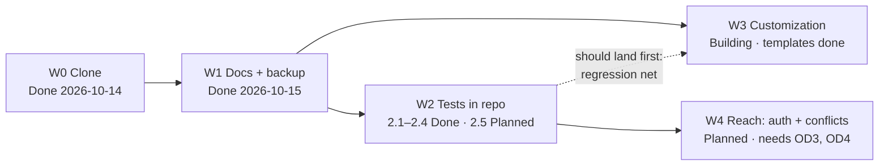

# OneNote Clone — Implementation Plan

The order of the work. [1_build-plan.md](1_build-plan.md) says what the system is. This file says
what gets built in what sequence, and why. Task statuses are edited in place:
`Planned` → `Building` → `Done` (verified) / `Cut`.

## Start here

*Rewritten 2026-10-17.*

- **Done:** W0, W1, W2.1–2.4, W3.2 (templates + planner), W3.3 (Road to Sabre), W3.4 (Theme tab), and
  W3.5 (note templates moved to Insert, Cards board, keyboard audit + P13 fix), and **W3.6 (movable
  everything, consistent across page kinds)**. `npm test`: 98 tests, 63.6 s, 30 of 30 guards proven
  by removal.
- **Reload open browser tabs.** No server restart needed (frontend-only change).
- **Next:** the owner's next customization (W3.7+). W2.5 (tests for the 33 `Written` features) can
  run alongside.
- **Waiting on a human:** the next customization; eventually OD4 (reachable from a phone?).

## 1. Dependency graph

W2 is the unit that de-risks everything after it. Every bug so far (P1–P7) was found by driving
the browser, and the scripts that did it lived outside the repo and are gone. W3 can start before
W2 finishes, but every customization made without the suite is checked by hand, once.

## 2. W0: Clone *(Done 2026-10-14)*

**Goal:** `npm start` serves a working OneNote look-alike whose notes survive a reload.

| # | Status | Task, with its acceptance test |
|---|---|---|
| 0.1 | Done | Schema + migrations: a fresh `DATA_DIR` starts with tables and a seeded "Getting started" page. *Seen 2026-10-14 and 2026-10-15.* |
| 0.2 | Done | REST API for notebooks/sections/pages/trash/search/uploads/backup. Each endpoint returns the shapes in the contract. *All captured 2026-10-15.* |
| 0.3 | Done | Shell UI matching the owner's screenshot (title bar, ribbon, rail, sections, pages). *Screenshots 2026-10-14, dark and light.* |
| 0.4 | Done | Freeform containers: a click on empty canvas creates one at the click point; dragging the handle moves it, and the position persists. *Moved to (260, 200), survived reload.* |
| 0.5 | Done | Autosave: typed text, tags, bold and ink survive a reload. *2026-10-14.* |
| 0.6 | Done | Formatting basics: heading style, font size, bold, To Do tag. *After the P1 fix.* |
| 0.7 | Done | Tables (with Tab between cells), picture upload. *After the P2/P3 fixes.* |
| 0.8 | Done | Ink: pen stroke persists; eraser removes it. |
| 0.9 | Done | Search pane finds a page by body text and opens it. |
| 0.10 | Done | Delete page → Undo restores it; new notebook; browser Back returns to the previous page. |
| 0.11 | Done | Paste strips `<script>`, `on*` and `javascript:`. *After the P4 fix, verified 2026-10-15.* |

**Not included:** sync, auth, mobile-first editing, OneNote file import, section groups, page
templates. **Checkpoint:** none. The owner looked at it and asked for customization next.

## 3. W1: Ground truth *(Done 2026-10-15)*

**Goal:** a returning reader can learn what exists, why, and how to run and back it up, and every
claim has been checked against the running system.

| # | Status | Task, with its acceptance test |
|---|---|---|
| 1.1 | Done | `docs/0_config.md` + `CLAUDE.md` session trigger. |
| 1.2 | Done | Files 1–6 written from captured output (API examples, timings, failure modes all observed 2026-10-15). |
| 1.3 | Done | `7_uml/` diagrams + `8_architecture.html` generated by `npm run docs:arch`. All 20 Mermaid blocks in the docs parse (one state-diagram label fixed); the page renders 18/18 in light and dark with no console errors; with the CDN blocked it shows the master SVG and all 18 sources; master diagram re-laid twice after looking at it. |
| 1.4 | Done | `npm run backup`: snapshot opens and has the same page count as the source (`9 pages`, scratch DB). Missing DB exits 1 with a message. |
| 1.5 | Done | Fix P5 (silent failed start), P6 (mobile ribbon), P7 (toast per retry). Each seen failing, then passing. |

**Not included:** writing the tests into the repo (W2), and anything that changes behaviour beyond
the three bug fixes.

## 4. W2: Tests in the repo *(2.1–2.4 Done 2026-10-15; OD1 answered → decisions 2026-10-15)*

**Goal:** `npm test` re-runs every check from 2026-10-14/15 against a throwaway server and exits
non-zero on any regression.

| # | Status | Task, with its acceptance test |
|---|---|---|
| 2.1 | Done | Harness (`tests/helpers.mjs`): free port, temp `DATA_DIR`, installed Chrome via `channel: 'chrome'` (Edge fallback). `npm test` runs with no setup beyond `npm install`. |
| 2.2 | Done | API tests: the contract's error table, both silent-failure obligations, export/import, P5 (`tests/api.test.mjs`). |
| 2.3 | Done | UI regression tests for P1, P2, P3, P4, P6, P7, plus P9 and the no-op save guard. All 9 seen failing with their fix removed. That check found P10 and a P3 test that failed for the wrong reason, both fixed. |
| 2.4 | Done | Persistence test: type, tag, bold, draw → reload → all present. |
| 2.5 | Planned | Work through the 31 **`Written`** features in [3_features.md](3_features.md) §3.4: a test per feature. Anything that fails becomes a P-entry. |

**Not included:** CI (there is no remote repo yet), cross-browser runs (Chrome only; Firefox would
be a separate decision). **Checkpoint:** after 2.5, if more than ~5 of the unverified features are
broken, spend a session on fixes before W3.

## 5. W3: Customization *(Building, one item at a time as the owner asks)*

**Goal:** the app fits how I actually take notes. Tasks are defined by the owner, one request at a
time rather than as one up-front list.

| # | Status | Task, with its acceptance test |
|---|---|---|
| 3.1 | Cut | ~~Owner writes the whole customization list up front.~~ The owner asks for items one at a time instead. Each still gets a row here with an acceptance test. |
| 3.2 | Done 2026-10-15 | **Page templates + to-do planner** (owner's request, modelled on their "Road to Sabre" checklist). Acceptance: `tests/templates.test.mjs` (6) and `tests/todo.test.mjs` (14) pass. The planner offers Month / Date / Tag views, progress, quick-add `#tag @date`, edit, undoable remove, and refuses canvas-only tools. |
| 3.3 | Done 2026-10-15 | **Recreate "Road to Sabre"** from the owner's screenshots in their Quick Notes. Acceptance: 41 tasks, 15/3/17/6 per month, 1 done, `1 of 41 done 2%` rendered (checked on a scratch copy first); backup taken before writing. |
| 3.4 | Done 2026-10-16 | **Theme tab** (owner's request): color schemes, make-your-own theme, and "various looks". Acceptance: `tests/theme.test.mjs` (13) passes; the 6 new guards fail with their fix removed; screenshots of Arctic + Modern, Paper + Cozy, Nightshade and Rose + Modern on the planner, and the editor during an unreadable preview (which found P11). |
| 3.5 | Done 2026-10-17 | **Owner feedback round:** (a) move the four note templates from "Add page" to Insert so they go into the current page; (b) make every keyboard shortcut work ("delete was not working"); (c) a **Cards** template like the Trello reference image. Acceptance: `templates.test.mjs` (7), `shortcuts.test.mjs` (19, presses all 30 listed shortcuts), `board.test.mjs` (11) pass; P13 reproduced first, then fixed; 7 new guards fail with their fix removed. |
| 3.6 | Done 2026-10-17 | **Consistency and movability** (owner: "consistency in features across all 3 templates… drag drop reordering for tasks in the to do list and also for lists in the cards template"). Acceptance: `moving.test.mjs` (13) and the new nudge test in `shortcuts.test.mjs` pass; Help lists 36 shortcuts; 8 new guards fail with their fix removed; grip handles checked in screenshots of a planner and a board. |
| 3.7 | Planned | Next owner request. |

**Not included:** anything that adds a build step or a second process without a decisions-log row
justifying it (system guide §8, habit 3).

## 6. W4: Reach *(Planned, optional)*

**Goal:** use it from a phone or second machine without exposing notes to the network.

| # | Status | Task, with its acceptance test |
|---|---|---|
| 4.1 | Planned | Settle OD4. Then an unauthenticated request from another device is refused. |
| 4.2 | Planned | Settle OD3. Then two tabs editing one page cannot silently overwrite each other. |

## Go/no-go checkpoints

| Checkpoint | Decided by | If yes | If no |
|---|---|---|---|
| Move search to FTS5? (OD2) | `/api/search` on the **real** `data/notes.db` takes > 150 ms (median of 5 warm `curl` calls) | Build FTS5 behind the same endpoint and response shape | Keep `LIKE`. Re-measure when the page count doubles. |
| Start W3 before W2 is complete? | W2.1–2.4 exist and pass | Start W3 | W3 items are each hand-verified and logged as such in 3_features.md |

## Documentation checkpoints

| Moment | What gets recorded, where |
|---|---|
| First `npm test` run (W2.1) | Test count and duration → 3_features.md §3.5, with the command |
| Each unverified feature checked (W2.5) | Its status → 3_features.md. A failure → a P-entry in 4_decisions.md |
| First measurement of search on real data | 3_features.md §3.5 and OD2 |
| Each customization lands | 3_features.md row + any decision; the contract if the API changed; diagrams if a flow changed |
| First use from a second device | OD3/OD4 graduate, or get new evidence |
