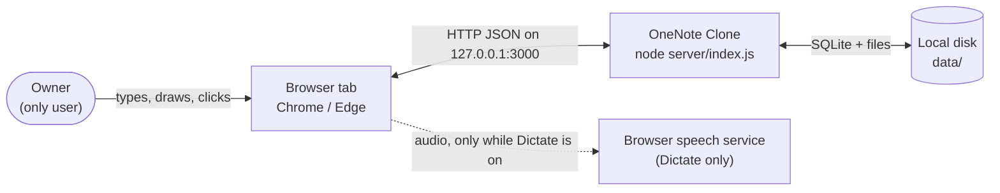
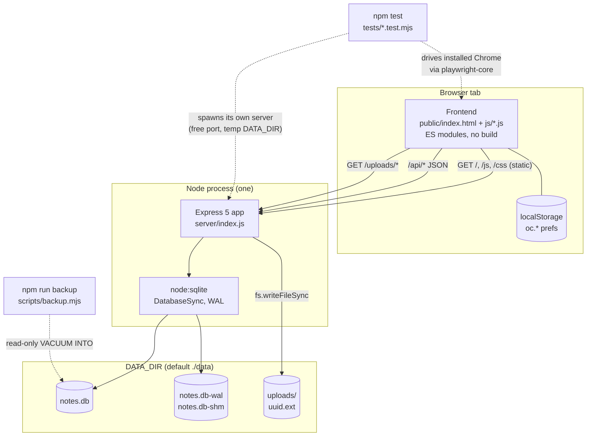
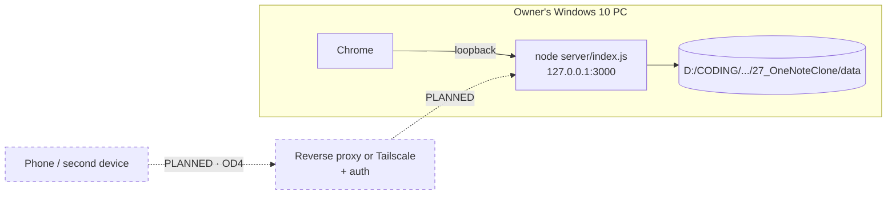

# 7.1 High-level design: context, containers, deployment

## Context

**Why:** the only external dependency at runtime is optional. Dictation uses the browser's
built-in Web Speech API, which in Chrome sends audio to Google's speech service. Everything else
works offline. No CDN, no account, no sync service. See [../1_build-plan.md](../1_build-plan.md) §1.

## Containers

**Why tests start their own server:** each suite gets a fresh database in the OS temp folder and
a free port, so `npm test` can run while the real server is up on 3000, and never touches
`data/`.

**Why:** one process owns the database, so there is no locking story to tell. `notes.db` and
`notes.db-wal` are drawn separately on purpose. Together they are the database, and on a small
notebook the WAL can hold everything (P8). The backup script is a separate short-lived process
that opens the DB read-only.

## Deployment

**Why:** bound to `127.0.0.1` because there is no authentication. The dashed path is not built.
It needs OD4 (how to protect it) and OD3 (two devices editing one page) settled first.
