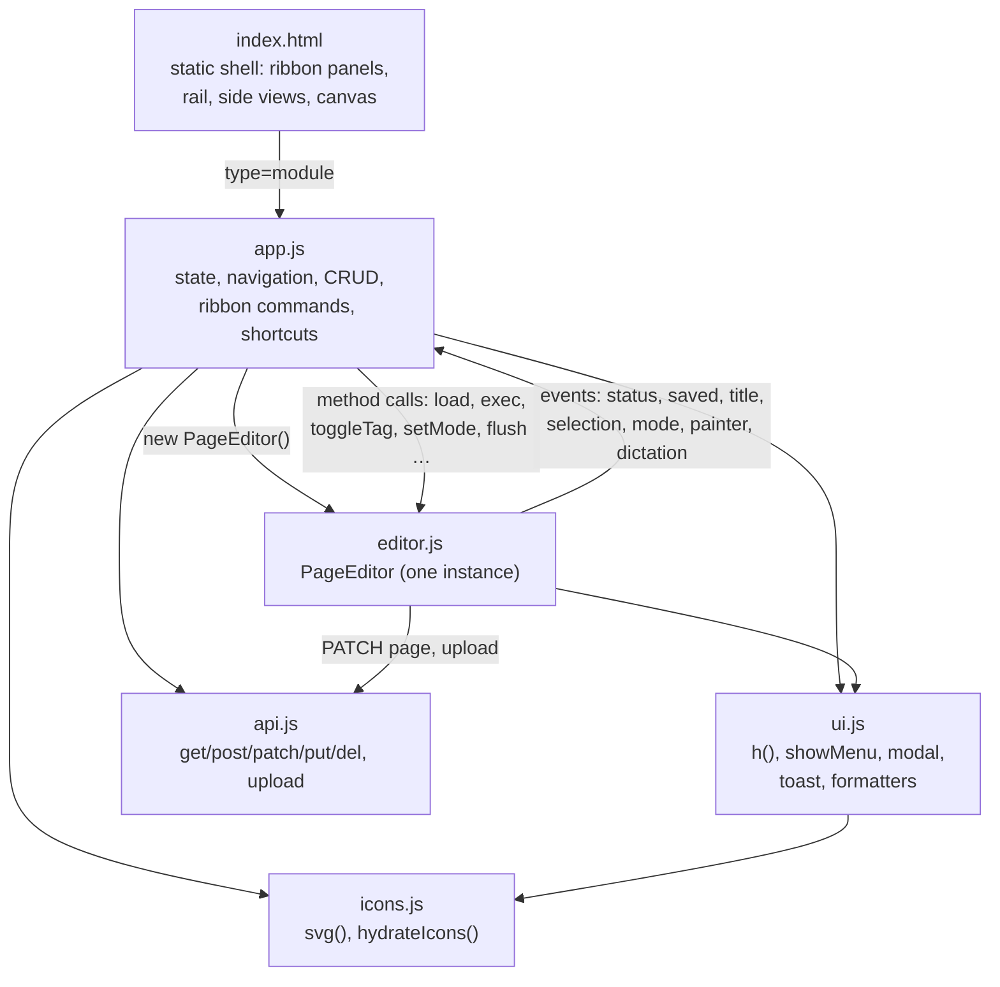
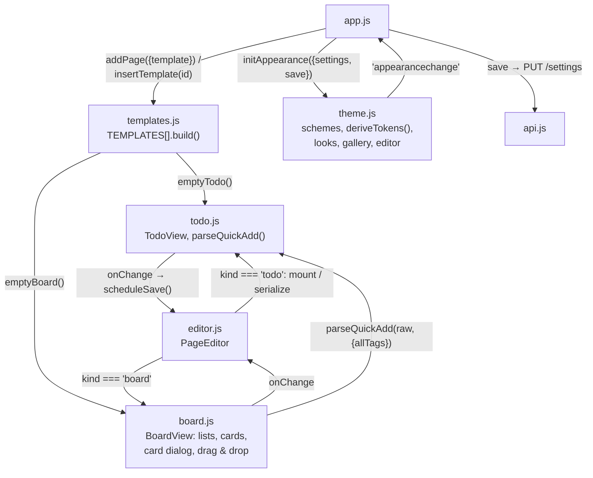
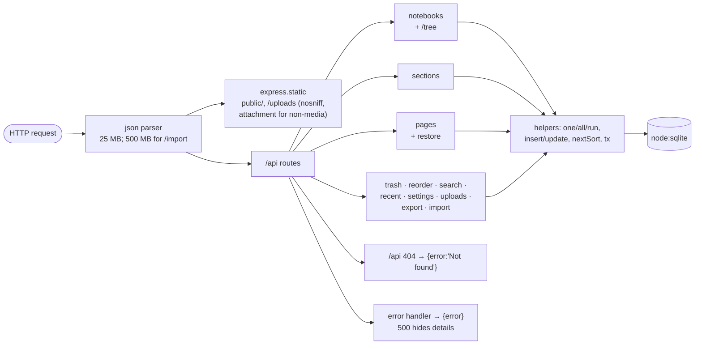
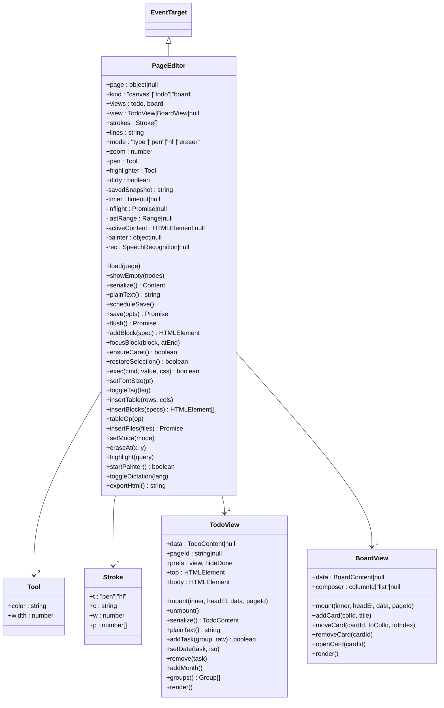

# 7.2 Low-level design: components and classes

## Frontend components

## Feature modules (added 2026-10-15/16)

Split out of the diagram above on 2026-10-16: with templates, planner and theme in it, the labels
were no longer legible at normal zoom.

**Why `todo.js` hangs off the editor, not `app.js`:** a planner is still a page. It is loaded,
autosaved (same 600 ms debounce, same no-op snapshot check), searched and exported through
`PageEditor`. Only the rendering and the meaning of `content` differ, so the editor references
`this.kind` 17 times (grep, 2026-10-15) to delegate or refuse. `app.js` checks `editor.kind` once,
to refuse "New note container" on a planner. Everything else in it is kind-agnostic.

**Why:** `PageEditor` knows one page and nothing about notebooks or sections. `app.js` never
touches the canvas DOM directly. It calls editor methods and listens to editor events (an
`EventTarget`). That boundary is where page-level customizations go (in `editor.js`) versus
organisation-level ones (in `app.js`).

## Server components

**Why:** routes are thin and synchronous. `DatabaseSync` means no `await` between reading and
writing, so a handler's statements cannot interleave with another request's. Multi-statement
writes (seed, create notebook, insert page after, reorder, import) are wrapped in `tx()`.

## PageEditor class

**Why `theme.js` doesn't call the API itself:** `app.js` hands it a `save` function
(`PUT /api/settings {appearance}`, debounced 300 ms). That keeps `theme.js` usable before the
server answers (boot, offline) and testable on its own, as the tests do by importing it directly in
the page.

**Why `TodoView` re-renders whole:** a planner is at most a few hundred rows, so rebuilding the
list on each structural change is cheaper to reason about than patching it. Two exceptions avoid
lost input. Typing in the eyebrow, description or a month note updates data without
re-rendering. Finishing an inline task edit swaps the input back for a span instead of
re-rendering, so a blur caused by clicking another control can't replace that control before its
click lands.

**Why `lastRange`:** clicking a ribbon control (or typing in the font-size box) moves focus out
of the page, and the selection with it. Every command starts with `restoreSelection()`, which puts
back the last range seen inside a container. Ribbon buttons also `preventDefault()` on mousedown
so focus usually never leaves.
