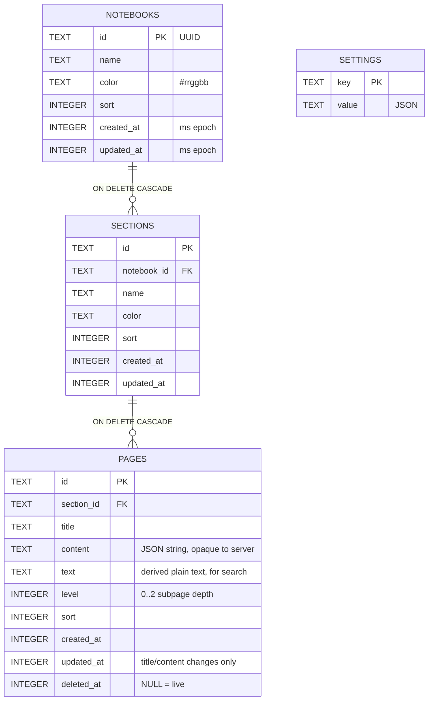
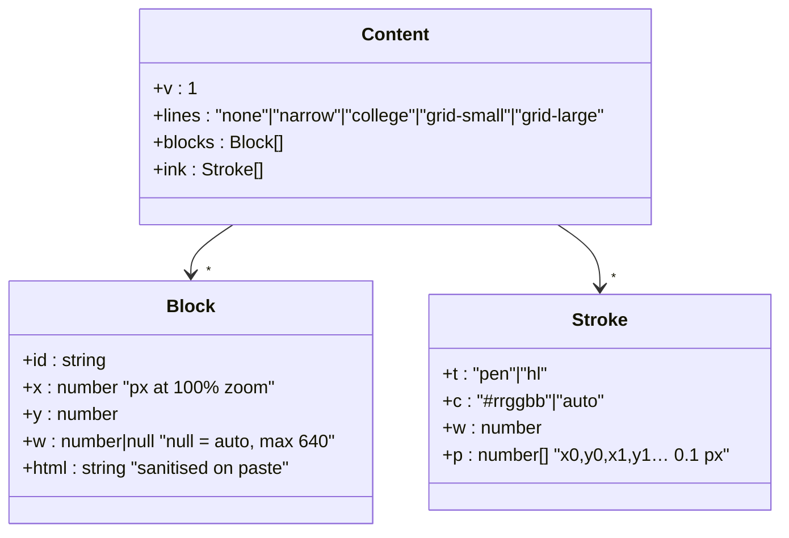
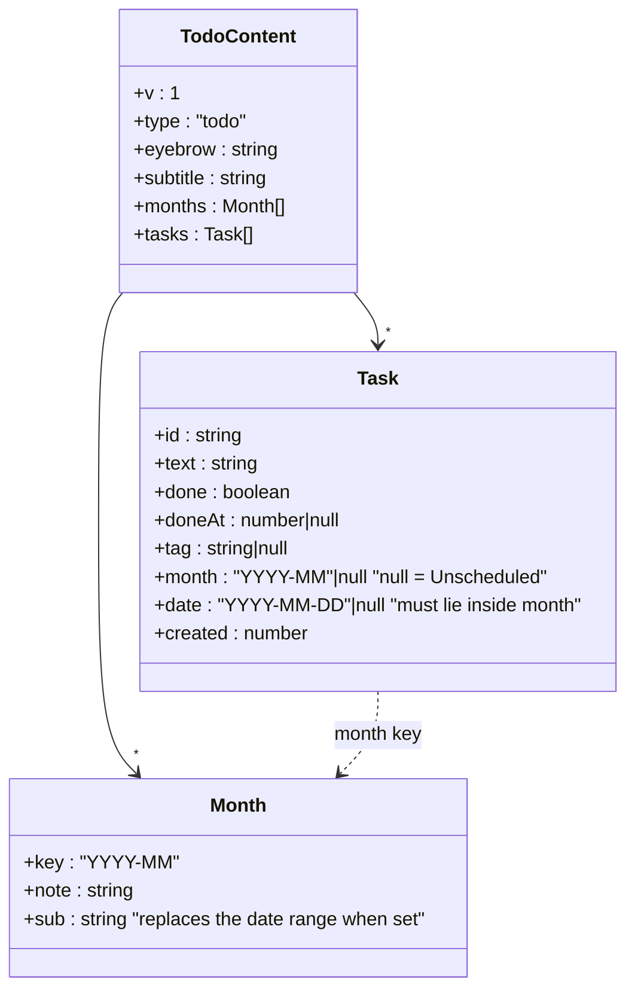
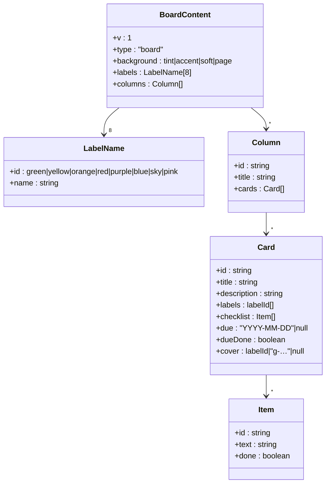
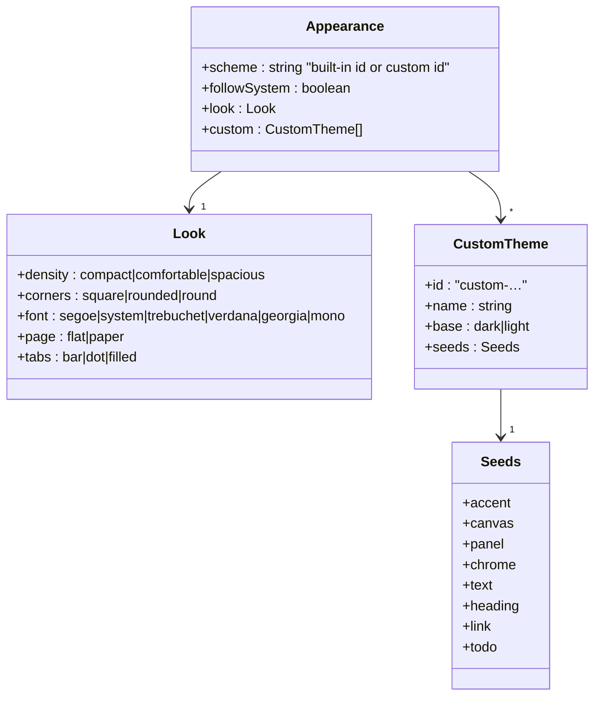

# 7.3 Data model

## Tables

Indexes: `sections(notebook_id, sort)`, `pages(section_id, sort)`, `pages(updated_at)`.
Schema version 1 (`PRAGMA user_version`), created by `server/db.js`.

**Why `text` exists:** search must not match HTML tags, attribute values or ink coordinates
inside `content`. The browser already has the rendered text, so it sends it with every save. This
is also the column's weakness: the server cannot recompute it (decisions 2026-10-14, contract
obligation 1).

**Why no `blocks` table:** a page is always loaded and saved whole, so per-container rows would
only add joins and a diff step (decisions 2026-10-14).

## What crosses the wire: `pages.content` v1

## What crosses the wire: `pages.content` for a planner (since 2026-10-15)

**Why month and date are separate:** the owner plans by month and dates only some tasks. A date
always wins: setting one sets `month` to match, and `normalizeTodo()` enforces it on load. The
Month/Date/Tag choice is deliberately **not** here. It lives in `localStorage` so switching views
never saves the page (decisions 2026-10-15).

## What crosses the wire: `pages.content` for a Cards board (since 2026-10-17)

**Why labels are a fixed 8:** cards stay comparable at a glance and no label-management UI is
needed. Only the *names* are per board (decisions 2026-10-17).

## `settings.appearance` (since 2026-10-16)

**Why only seeds are stored, never derived tokens:** the derivation can improve (e.g. better
contrast rules) and every stored theme gets the improvement on its next load. The only derived
copy is the first-paint cache in `localStorage`, which is rewritten on every apply.

Inside `Block.html`, tags are attributes on paragraph elements:
`
…
`. Images are `.png">`.
Attachments are `<a class="attachment" contenteditable="false" href="/uploads/…">`.

**Why points, not SVG path strings, in `Stroke.p`:** the eraser does a distance-to-segment test.
Path strings would force hit-testing rendered SVG, which barely hits 1–2 px lines (decisions
2026-10-14).
