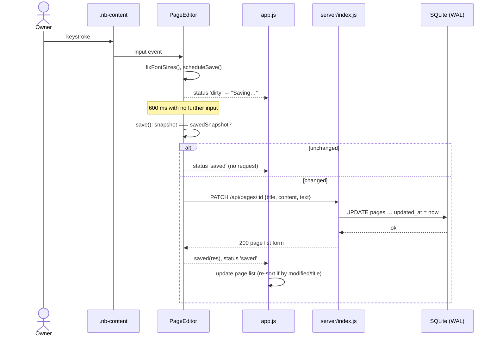
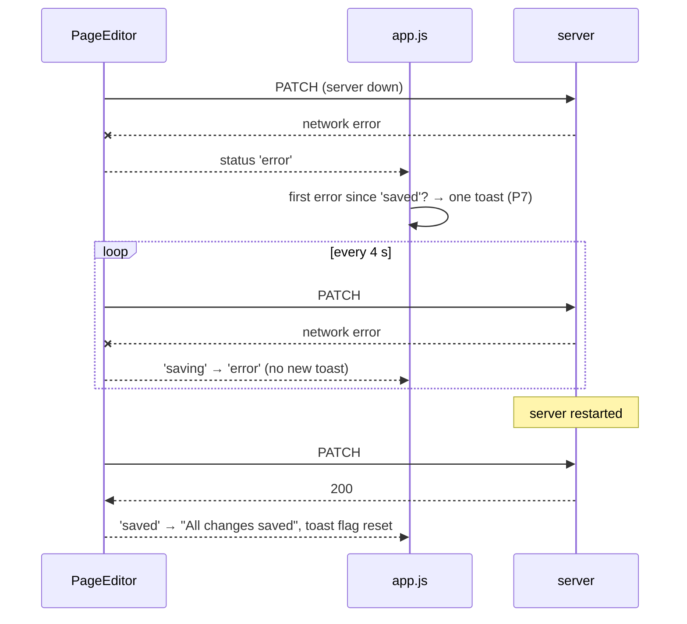
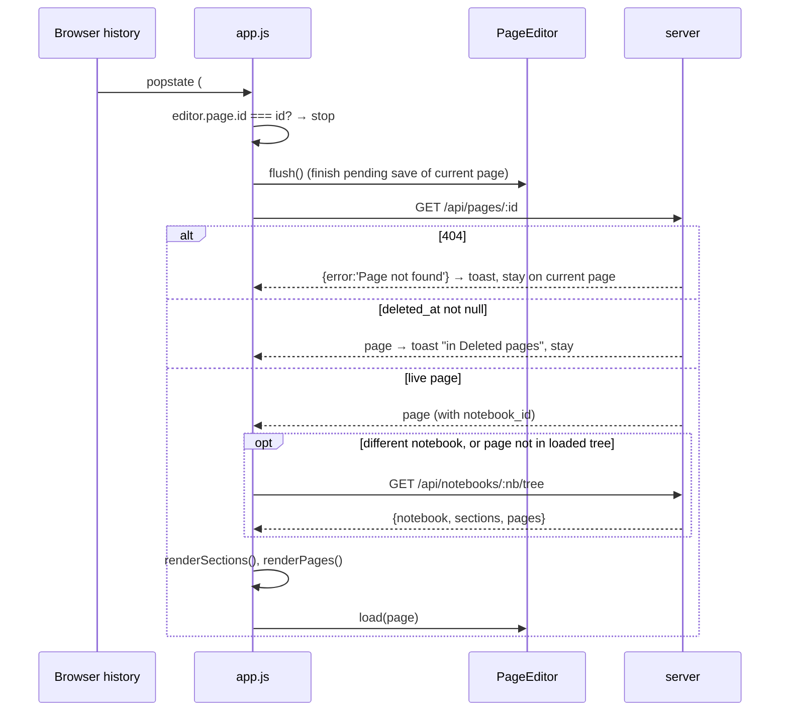
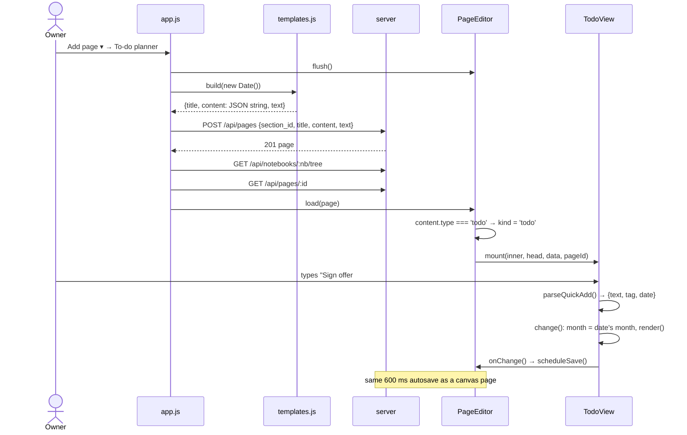
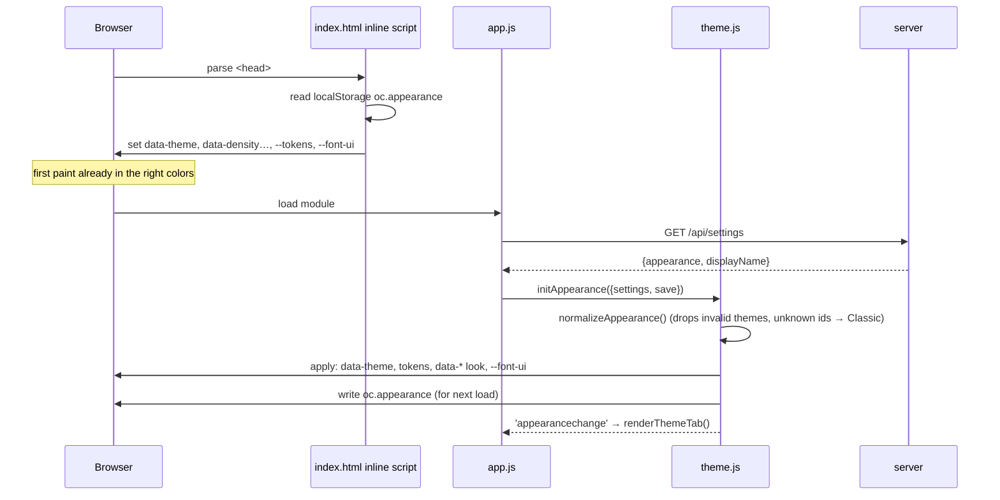
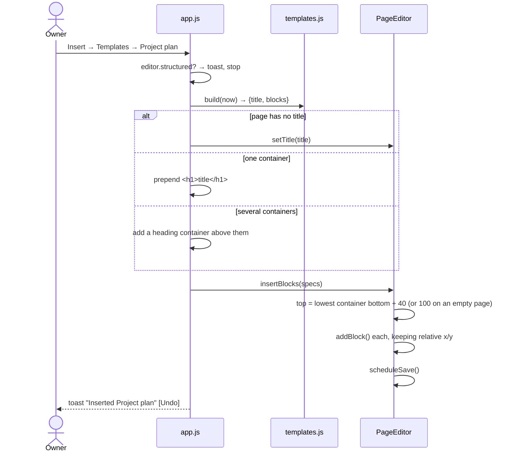
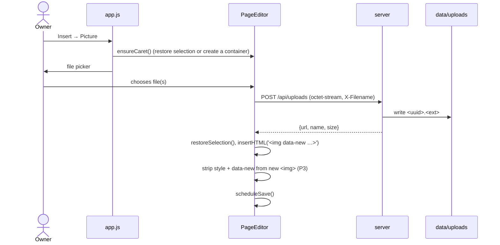

# 7.4 Sequences

## Typing → durable

**Why the snapshot check:** without it, clicking and leaving an empty container saves and bumps
`updated_at`. Measured: 0 requests with the check, 1 with it removed (2026-10-15).

## Server down during an edit

## Opening a page from a link, Back, or a search result

**Why `openSeq`:** each open increments a counter and drops its result if a newer open started
meanwhile, so fast clicking through pages can't load an older page last.

## New page from a template, then adding a planner task

**Why one POST with the content:** the page never exists empty, and its text is searchable at
once (tested: `milestones` finds a fresh Project plan with no edits).

## Loading the app: the theme before first paint

**Why two applies:** the cache can be stale (another browser changed the theme), so the server's
copy always wins a moment later. The cache only decides the first frame. Tested by blocking
`app.js` entirely: the cached accent and density still apply.

## Insert → Templates (since 2026-10-17)

**Why below, not at the caret:** a template is several positioned containers. Dropping them at
the caret would overlap whatever is there; below the lowest container never overlaps.

## Inserting a picture

**Why octet-stream:** a JSON file sent as `application/json` would be eaten by the global JSON
parser (`400 Empty upload`, observed 2026-10-15).
