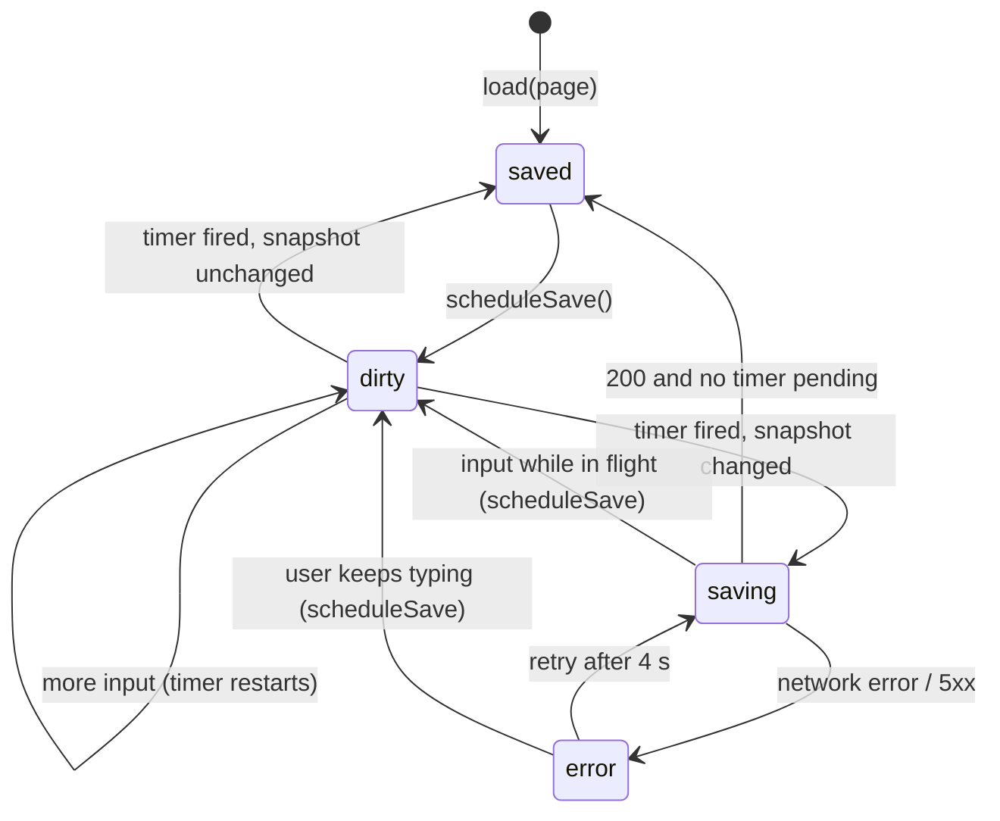
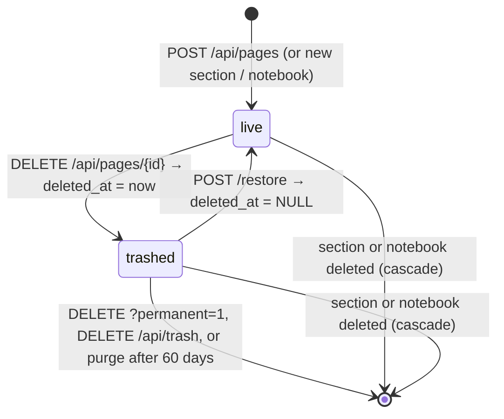
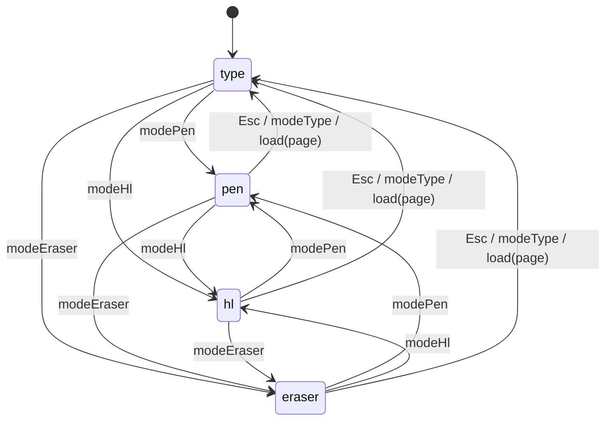
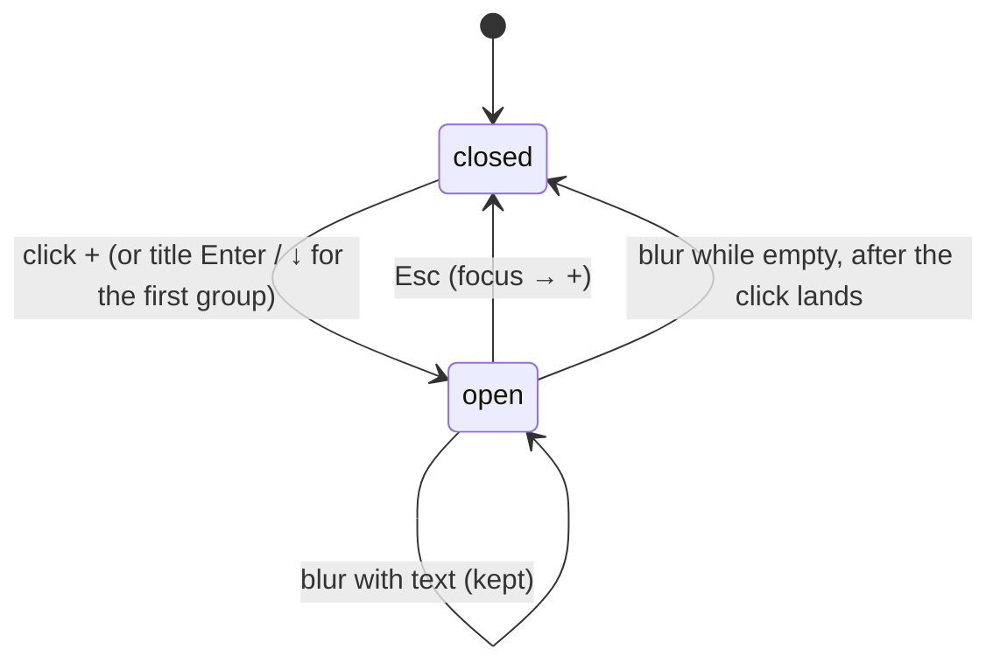
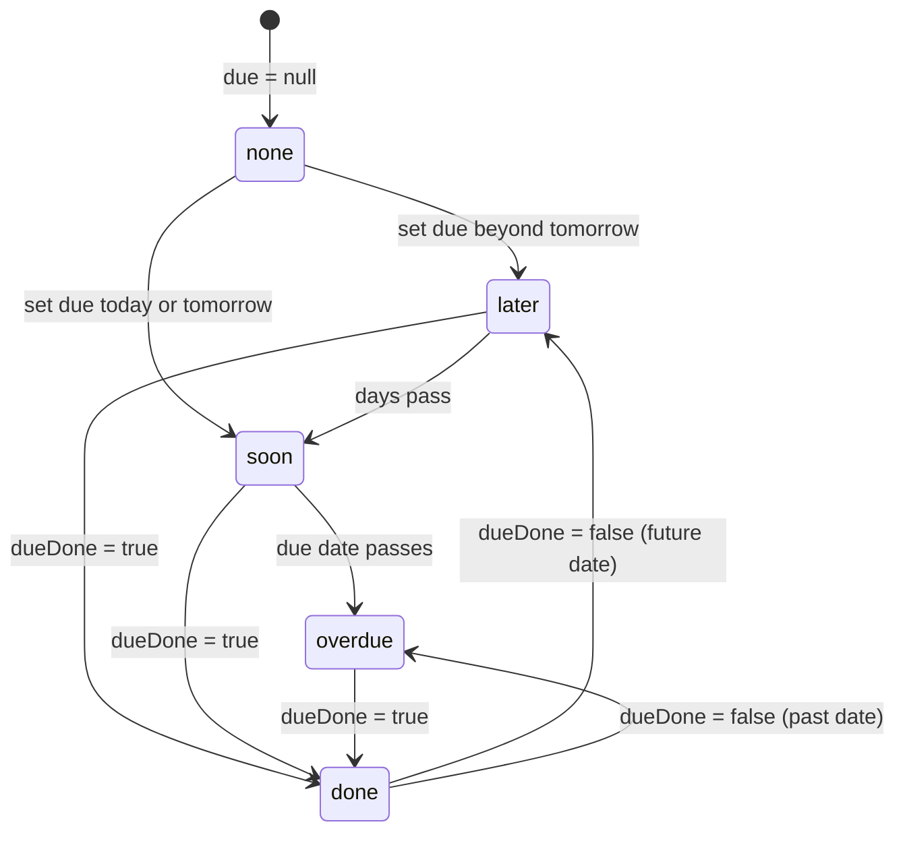

# 7.5 State machines

## Save status (the title-bar indicator)

Values are the strings `PageEditor` emits as `status` events.

**Why it matters:** the toast fires on the first `error` after a `saved`, not on every entry into
`error`. Each retry passes through `saving → error`, and the earlier version toasted every time
(P7).

## Page lifecycle

**Why the cascade edges matter:** deleting a section also destroys its trashed pages. The trash
does not protect them (contract obligation 6).

## Editor tool mode

In any mode other than `type`, the ink SVG takes pointer events (class `draw` on `#pageInner`), so
containers cannot be clicked. Opening another page always returns to `type`. A pen's eraser end
(`pointerdown` with `button === 5`) erases even in `pen` mode.

## Planner add box (since 2026-10-17)

One per page view (`openAdd` in `todo.js`). Never stored.

**Why "after the click lands":** focus leaves on `pointerdown`; removing the box then would shift
the rows below it before `pointerup`, and the click would miss (decisions, 2026-10-17).

## Card due badge (since 2026-10-17)

Computed by `dueState()` in `board.js` on every render, from `due`, `dueDone` and today's date.

Clearing the due date returns any state to `none` (edges omitted for legibility). Badge colors:
`overdue` red, `soon` yellow, `done` green, `later` plain. **Why a state machine
here:** four values, and the date-driven edges (`later → soon → overdue`) happen without any edit,
so a stored status would go stale. The state is never stored.
