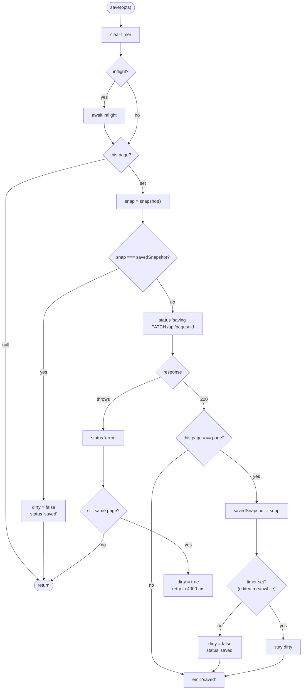
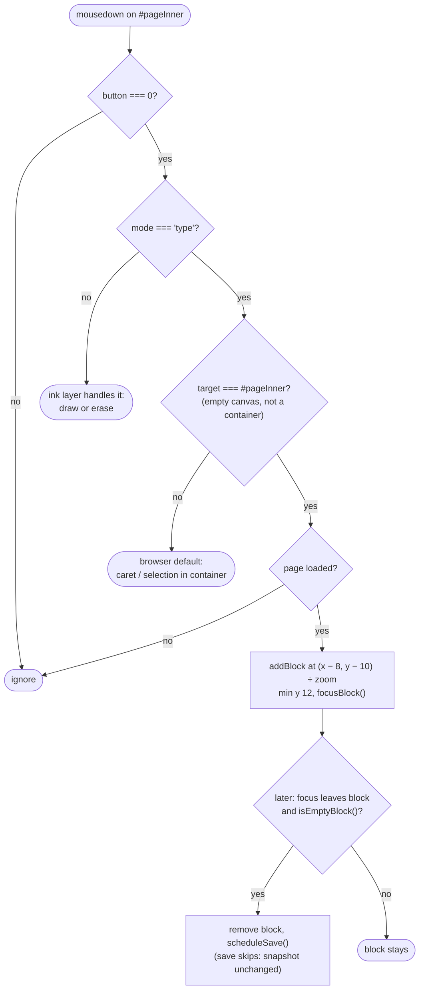
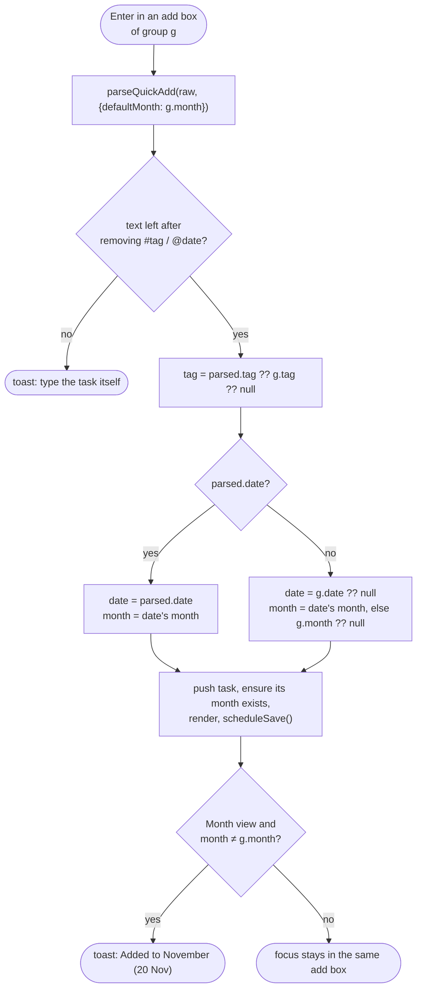
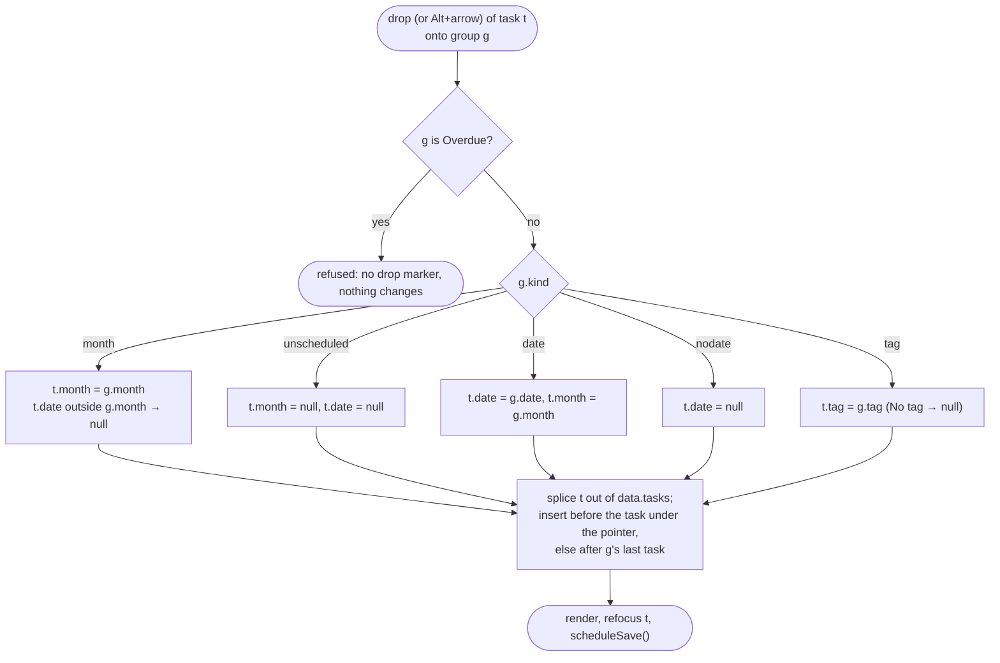
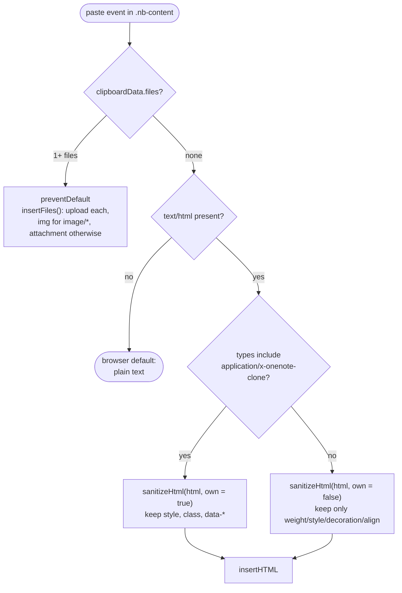

# 7.6 Activity: where the logic branches

## `save()`: save or skip

## Mouse down on the canvas

**Why the focus check ignores the ribbon:** clicking the font-size box moves focus out of the
container. The `focusout` handler skips removal when focus went to `.ribbon`, `.menu` or a modal,
so a fresh empty container survives choosing its formatting first.

## Where a new planner task lands

Group kinds that set defaults: a month group (`g.month`), a date group (`g.date`, `g.month`), a
tag group (`g.tag`), "No date" / "No tag" / "Unscheduled" (nothing), and the top add box in
Date and Tag views (nothing). The Overdue group has no add box.

## Where a dropped planner task lands

`applyGroup()` + `moveTask()` in `todo.js`. Alt+↑/↓ is the same move with "before" = the
neighbouring task; Alt+←/→ is a drop at the end of the previous/next non-Overdue group.

## Paste into a container

Both sanitiser paths drop `<script>`, `<style>`, `<iframe>`, forms, all `on*` attributes,
non-http(s) links, and any `` left without a `src` (P4).
